# Pramaan AI

**Research, with evidence.** Pramaan is an evidence-first AI research workspace. Ask a question; a team of research agents searches the web, academic literature and your own documents, extracts verbatim evidence, turns it into claims, verifies every claim against that evidence, and writes a report in which **every citation is mapped deterministically to a real source** — never generated by a model.

| | |
| --- | --- |
| **Live app** | Vercel (static React app, Vite) |
| **API** | Render (FastAPI, native Python) |
| **Status** | Production — free-tier infrastructure |

---

## Contents

1. [System architecture](#1-system-architecture)
2. [The research agents](#2-the-research-agents)
3. [Lifecycle of a research request](#3-lifecycle-of-a-research-request)
4. [Document indexing](#4-document-indexing)
5. [Citations and verification](#5-citations-and-verification)
6. [Resilience and degradation](#6-resilience-and-degradation)
7. [Data model](#7-data-model)
8. [Authentication and access control](#8-authentication-and-access-control)
9. [Frontend architecture](#9-frontend-architecture)
10. [API reference](#10-api-reference)
11. [Local development](#11-local-development)
12. [Testing and CI](#12-testing-and-ci)
13. [Deployment](#13-deployment)
14. [Configuration reference](#14-configuration-reference)
15. [Repository layout](#15-repository-layout)

---

## 1. System architecture

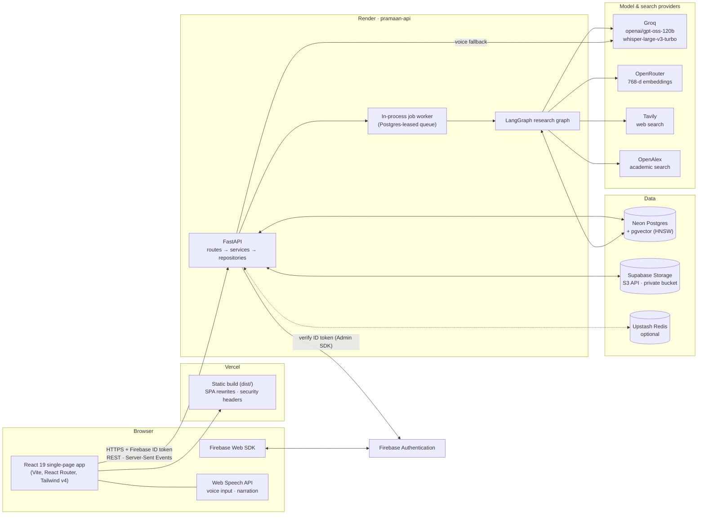

| Layer | Technology | Responsibility |
| --- | --- | --- |
| Frontend | React 19, Vite, React Router, TypeScript, Tailwind v4, Framer Motion | Single-page app: UI, client-side routing, streaming progress, demo mode |
| Voice | Web Speech API (browser); Groq Whisper fallback | Dictating questions; reading reports aloud |
| Identity | Firebase Authentication (email/password, Google) | Sign-in; the backend verifies ID tokens with the Admin SDK |
| API | FastAPI, SQLAlchemy 2 (async, asyncpg), Pydantic v2 | REST API, SSE progress stream, access control |
| Research | LangGraph | Multi-agent research pipeline (§2) |
| Jobs | Postgres-backed queue with leases | Research and indexing run outside the request, survive restarts |
| Database | Neon PostgreSQL + pgvector (HNSW, 768-d) | All application data, document chunks and vectors |
| Files | Supabase Storage via its S3-compatible API | Uploaded originals and extracted text |
| Text generation | Groq — `openai/gpt-oss-120b` | Planning, claim extraction, verification, synthesis |
| Speech-to-text | Groq — `whisper-large-v3-turbo` | Voice input in browsers without built-in recognition |
| Embeddings | OpenRouter — `nvidia/nemotron-3.5-embed-8b:free`, 768 dimensions | Semantic ranking and retrieval |
| Search | Tavily (web), OpenAlex (academic) | Source discovery |
| Cache (optional) | Redis (Upstash) | Shared rate limits, search & query-embedding caches, progress pub/sub |

---

## 2. The research agents

Each research run executes a **LangGraph state graph**. Every node is a focused agent that reads the shared `ResearchState`, does one job, reports progress, and returns a partial state update. The three discovery agents run **in parallel**.

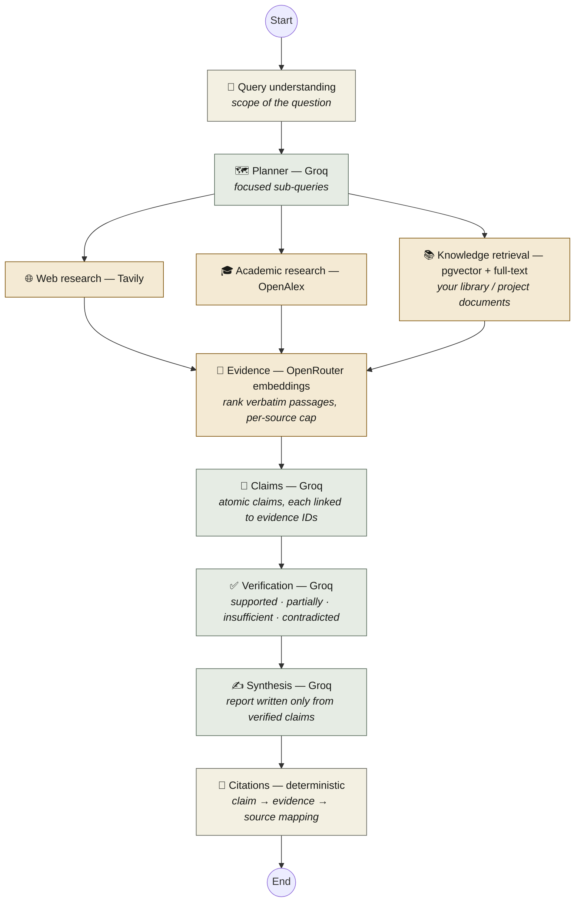

| Agent | Input | Output | Uses |
| --- | --- | --- | --- |
| **Query understanding** | Question, project, channels | Research scope | — |
| **Planner** | Question, project instructions, prior project research | 2–5 sub-queries (by mode) | Groq |
| **Web research** | Sub-queries | Web sources + snippets | Tavily (Redis-cached) |
| **Academic research** | Sub-queries | Papers, authors, abstracts | OpenAlex (Redis-cached) |
| **Knowledge retrieval** | Question, authorised document IDs | Ranked document chunks with page numbers | pgvector HNSW + Postgres full-text, fused with reciprocal rank fusion |
| **Evidence** | All sources and chunks | Up to 12 / 24 / 40 verbatim passages (E1…En) | OpenRouter embeddings + keyword overlap |
| **Claims** | Evidence | Up to 6 / 10 / 16 claims (C1…Cn), each citing evidence IDs | Groq |
| **Verification** | Claims + their evidence | Status and confidence per claim | Groq |
| **Synthesis** | Verified claims only | Summary, findings, analysis, limitations — shaped by mode and the user's response-length preference | Groq |
| **Citations** | Draft + claims + evidence | Final report with `[n]` markers resolved to stored sources | Deterministic code |

**Research modes** set the breadth of every agent:

| Mode | Sub-queries | Web results | Papers | Library chunks | Evidence | Claims |
| --- | ---: | ---: | ---: | ---: | ---: | ---: |
| Quick | 2 | 5 | 3 | 6 | 12 | 6 |
| Standard | 3 | 6 | 5 | 10 | 24 | 10 |
| Deep | 5 | 8 | 8 | 16 | 40 | 16 |

---

## 3. Lifecycle of a research request

Research never runs inside an HTTP request. It is queued in Postgres, claimed by the worker under a **lease**, and streamed back to the browser.

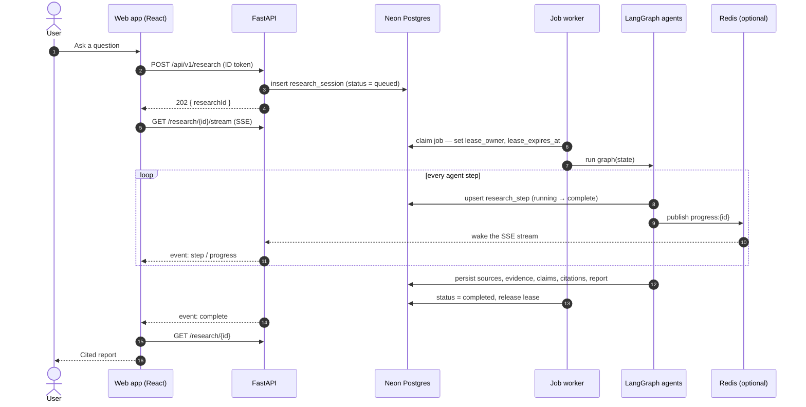

- **Leases and recovery.** A worker renews its lease while it runs. If the process dies, the sweep loop (every 60 s) re-queues expired jobs, up to `JOB_MAX_ATTEMPTS`, then marks them failed with a user-safe message. Duplicate deliveries are ignored because only the lease owner may write results.
- **Progress without Redis.** The SSE stream polls the database every 0.5 s; with Redis it sleeps until a pub/sub notification (with a 3 s safety poll).
- **Cancellation, retry and follow-ups** reuse the same queue.

### Follow-ups

Every follow-up on a finished report is routed to one of two workflows (`backend/app/research/follow_ups.py`). The model decides; a keyword heuristic is the fallback when it's unavailable.

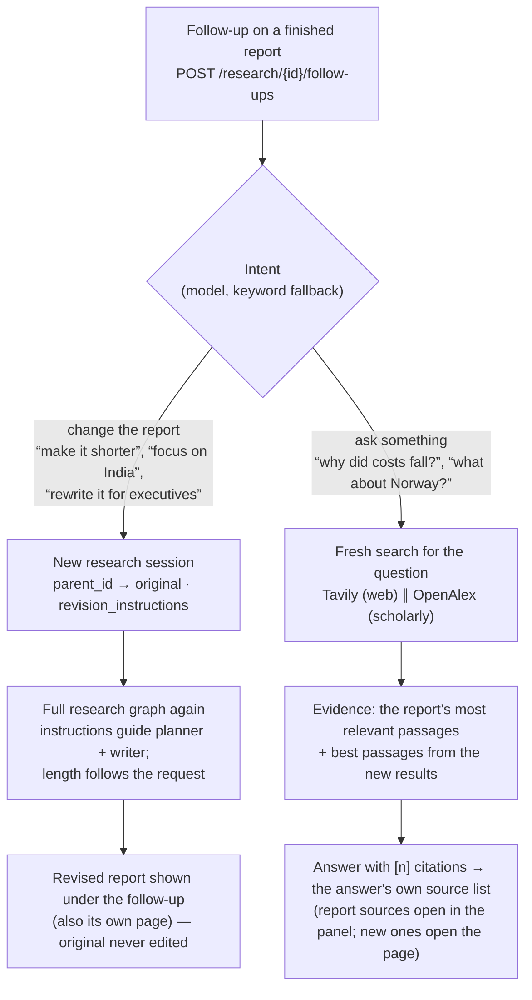

- **Revisions** are ordinary research jobs: queued, leased, retryable, shown with the same live "thinking" animation, and listed in history as "… (revised)". The revision page links back to the original.
- **Answers** keep working if a search provider is down — they fall back to the report's own evidence. The thread's earlier questions and the report summary are passed as context, so "what about the second one?" resolves.

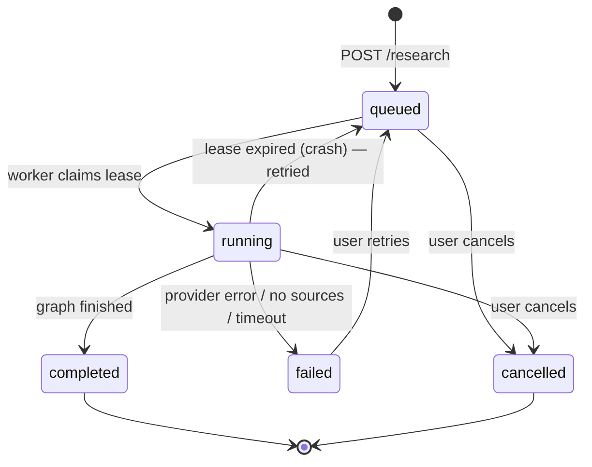

---

## 4. Document indexing

Uploaded files and imported web pages become searchable private evidence.

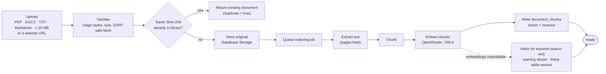

Statuses shown in the UI: `uploading → extracting → chunking → embedding → indexing → ready` (or `failed` with a specific, retryable message).

---

## 5. Citations and verification

Models never write citation numbers or links. They reference **claim IDs**; code resolves those to sources.

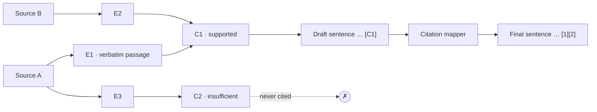

The citation mapper:

- keeps a marker only if the claim is **supported** or **partially supported**, its evidence exists, and the sentence actually restates the claim (≥ 20 % term overlap). Commentary the model adds keeps its text but loses the citation;
- numbers sources in order of first appearance, so citation *n* is always source *n* in the side panel;
- strips invented numbers, links and URLs, and resolves bare IDs (`supported by C1`) only in citation position, so terms like "C4" survive;
- records run degradations (e.g. semantic ranking unavailable) as plain-language **Limitations** in the report.

---

## 6. Resilience and degradation

| Failure | Behaviour |
| --- | --- |
| Groq unavailable / rate-limited | Retried with back-off (honours `Retry-After`, capped at 20 s); then the job fails with a specific, retryable message (`MODEL_UNAVAILABLE`, `MODEL_TIMEOUT`, …) |
| Embedding service down or slow | Bounded to 25 s × 2 attempts. Research continues with keyword ranking; library retrieval falls back to full-text search; documents index for keyword search. The report and the document page say so |
| Web or academic search fails | That channel contributes nothing; the run continues and records a limitation |
| No relevant sources | Job fails with `NO_SOURCES` ("Pramaan couldn't find enough relevant sources") |
| Redis unavailable | Fail-open with a 30 s cool-down: in-process rate limiter, no cache, polling progress |
| Process restart mid-run | Lease expires; the sweep re-queues the job |
| Neon idle disconnect | Pool recycling + pre-ping; prepared statements stay on for latency |

Provider errors are logged with HTTP status, a truncated provider message and the provider request id — never request bodies, prompts or keys.

---

## 7. Data model

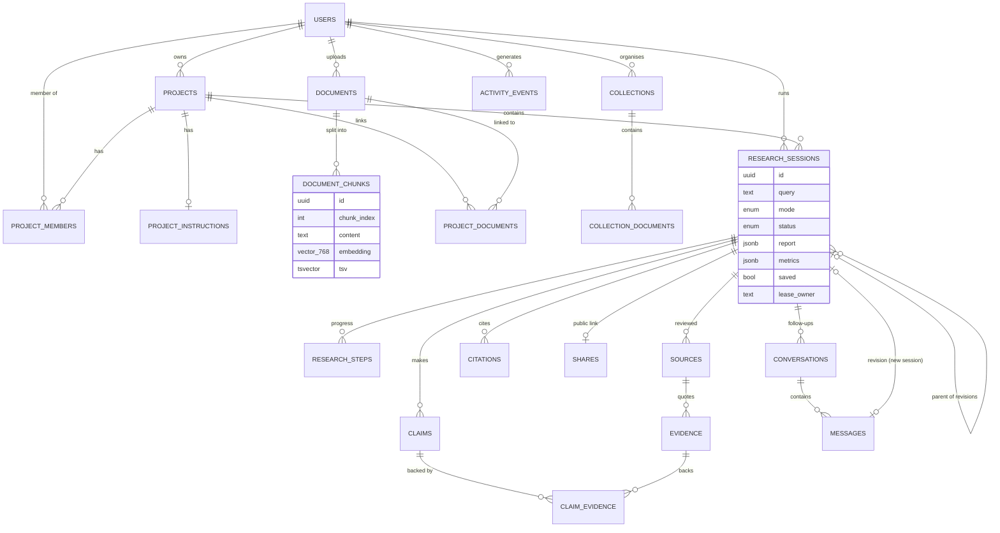

Every table that references a user cascades on delete, so **deleting an account removes all of its data** in one statement; stored files are deleted right after. Schema changes go through Alembic (`backend/app/db/migrations/`).

---

## 8. Authentication and access control

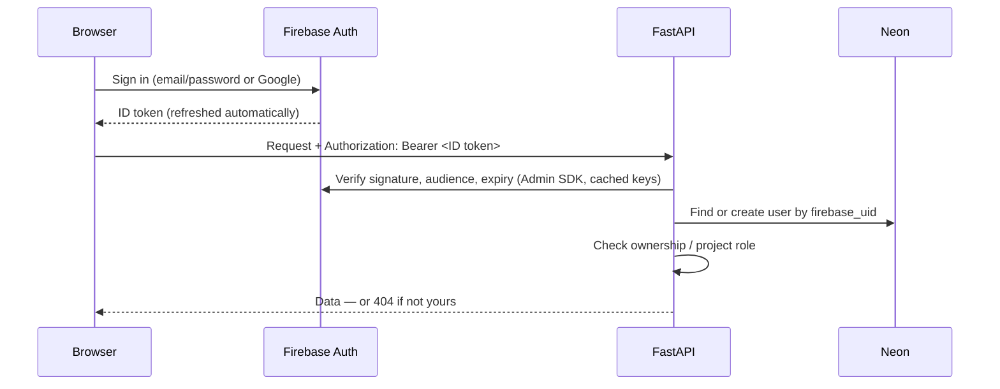

- **Isolation:** every query is scoped to the caller. Another user's resources return **404**, not 403, so their existence is never revealed.
- **Project roles:** `owner` (members, delete) · `editor` (research, upload, instructions, project settings) · `viewer` (read). Owners add existing verified accounts by email.
- **Sensitive actions** (account deletion) require a fresh sign-in on the client.
- **Hardening:** strict CORS allow-list, request-size limit, per-user rate limiting, SSRF-safe URL fetching, HSTS in production, CSP / `X-Frame-Options` / nosniff / Referrer-Policy on the frontend, API docs disabled in production.

---

## 9. Frontend architecture

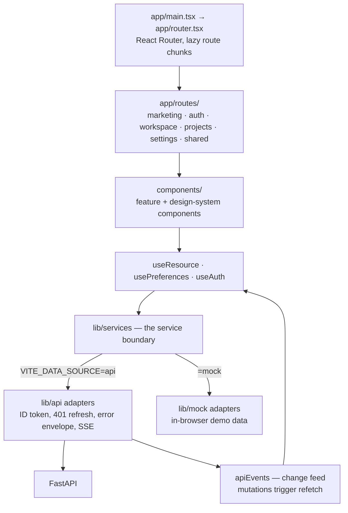

- **Single-page app.** Vite builds a static bundle; `app/router.tsx` maps every URL to a lazily loaded route module (one chunk per area), with layouts as nested routes. Page titles are set per route; unknown paths render the not-found page and the host returns a real 404 for them (§13).
- **One service boundary.** UI code only talks to `services.*`. API and mock adapters share one typed surface, so the app runs fully in **demo mode** without a backend.
- **Research view** follows the real job state: a branded loading screen while queued/running, the cited report on completion, and a side panel listing every source (a sheet on small screens).
- **Preferences** (default mode and sources, citation style — numeric, APA, MLA or Chicago — response length, notifications, retention) are stored on the profile and follow the account across devices; theme and motion stay per device.
- **Voice.** The mic button in the research composer dictates a question — live, word by word, with the browser's speech recognition (Chrome, Edge, Safari); browsers without it (Firefox) record a short clip that `POST /speech/transcriptions` transcribes with Groq Whisper (never stored). **Listen** (beside Share and Export) reads the whole report aloud with the browser's speech synthesis: title, summary, findings, analysis, evidence and limitations, without citation markers; a docked player pauses, skips between sections, and changes speed and voice, and the section being read is marked in the report.
- **Accessibility:** WCAG 2 AA contrast, labelled controls, focus-trapped dialogs, larger touch targets on coarse pointers, reduced-motion support.

---

## 10. API reference

All routes are under `/api/v1` and require a Firebase ID token unless noted. Errors always use `{"error": {"code", "message", "request_id"}}`; JSON is camelCase.

| Method & path | Purpose |
| --- | --- |
| `GET /health`, `GET /ready` *(public)* | Liveness; readiness (database, pgvector, Redis) |
| `GET /health/warmup` *(public, rate-limited)* | Cheap wake-up for the free tier |
| `GET`, `PATCH`, `DELETE /me` | Profile and preferences; permanently delete the account |
| `GET /me/export`, `GET /me/usage` | JSON export of everything you own; this month's usage |
| `GET /search?q=` | Search your research, projects and documents |
| `GET`, `POST /projects` · `GET`, `PATCH`, `DELETE /projects/{id}` | Projects |
| `GET`, `PUT /projects/{id}/instructions` · `GET /projects/{id}/activity` | Instructions and activity |
| `POST /projects/{id}/members` · `PATCH`, `DELETE /projects/{id}/members/{userId}` | Add by email, change role, remove or leave |
| `POST`, `DELETE /projects/{id}/documents/{docId}` | Attach or detach a document |
| `GET /library` · `POST /library/upload` · `POST /library/urls` | Library, upload, import a website |
| `GET`, `DELETE /library/{id}` · `POST /library/{id}/retry` · `GET /library/{id}/download` | Document detail, delete, retry, original file |
| `POST /research` (202) · `GET /research` | Start research; history |
| `GET`, `PATCH`, `DELETE /research/{id}` | Result; save, rename, move; delete |
| `GET /research/{id}/stream` | Server-Sent Events progress |
| `POST /research/{id}/retry`, `/cancel` · `PUT /research/{id}/share` | Lifecycle, public link |
| `POST /research/{id}/follow-ups` (202) | Ask a follow-up: a change request starts a revised report (`kind: "revision"`, `revisionId`); a question is answered with fresh web + scholarly search (`kind: "answer"`, `sources`) |
| `GET /shared/{token}` *(public)* | Read-only shared report |
| `POST /speech/transcriptions` | Transcribe a short voice recording (multipart `audio`, optional `language`); rate-limited, nothing stored |

Interactive docs (`/docs`, `/redoc`, `/openapi.json`) are available in development only.

---

## 11. Local development

**Prerequisites:** Node 22, Python 3.12, PostgreSQL 16+ with the `pgvector` extension, Firebase CLI (for the Auth emulator).

### Demo mode — no backend, no keys

```bash
npm install
VITE_DATA_SOURCE=mock npm run dev               # http://localhost:3000
```

### Full stack

```bash
# 1. Backend
cd backend
python3.12 -m venv .venv && .venv/bin/pip install -r requirements-dev.txt
cp .env.example .env                              # fill in keys (see §14)
createdb pramaan && psql pramaan -c 'CREATE EXTENSION IF NOT EXISTS vector'
.venv/bin/alembic upgrade head
.venv/bin/uvicorn app.main:app --reload --port 8000

# 2. Frontend (repository root)
cp .env.example .env.local                        # Firebase web config + VITE_API_URL=http://localhost:8000
npm run dev
```

### Without real accounts — Firebase Auth emulator

```bash
npm run emulators                                 # Auth emulator on 127.0.0.1:9099
FIREBASE_AUTH_EMULATOR_HOST=127.0.0.1:9099 backend/.venv/bin/uvicorn app.main:app --port 8000   # from backend/
npm run dev:emulator
```

Set `STORAGE_BACKEND=local` to keep files on disk during development. `LLM_PROVIDER=fake` and `EMBEDDING_PROVIDER=fake` run the whole pipeline offline with deterministic extractive output.

---

## 12. Testing and CI

```bash
# Frontend
npm run lint && npm run typecheck && npm test     # ESLint, tsc, Vitest
npm run build && npm run preview                  # production bundle in dist/, served like Vercel serves it

# Backend (needs a migrated database whose name contains "test")
cd backend
DATABASE_URL=postgresql+asyncpg://localhost:5432/pramaan_test .venv/bin/alembic upgrade head
DATABASE_URL=postgresql+asyncpg://localhost:5432/pramaan_test .venv/bin/pytest
.venv/bin/ruff check app tests && .venv/bin/ruff format --check app tests && .venv/bin/mypy app

# End-to-end
BASE_URL=http://localhost:3000 npm run e2e        # smoke suite (works against a demo build)
node e2e/workflows.mjs --real-research            # signed-in workflows: emulator + local backend
```

| Suite | Covers |
| --- | --- |
| Backend (pytest, real Postgres + pgvector) | Cross-user isolation, job leases and recovery, research pipeline, citation mapping and fidelity, provider failures (Groq, OpenRouter), S3 storage (moto), Redis (fakeredis), account deletion/export/retention, members, search |
| Frontend (Vitest) | Research phase logic, API mapping, citation styles, preference sync, upload rules, redirects, validation, security headers, hosting rewrites, narration script, dictation |
| `e2e/smoke.mjs` | Headers, real 404s, pricing, privacy page, auth validation and deep links, responsive settings, billing, search, composer limits, dialog focus, voice input, Listen |
| `e2e/workflows.mjs` | Real backend: search, preference sync, members, uploads and duplicates, deletes, attachments, export, billing, account deletion, real research |

**CI** (`.github/workflows/ci.yml`) runs on every push to `main` and every pull request: lint, types, unit tests, production build and the e2e smoke suite for the frontend; ruff, format check, mypy, migrations and the full pytest suite against `pgvector/pgvector:pg17` for the backend.

---

## 13. Deployment

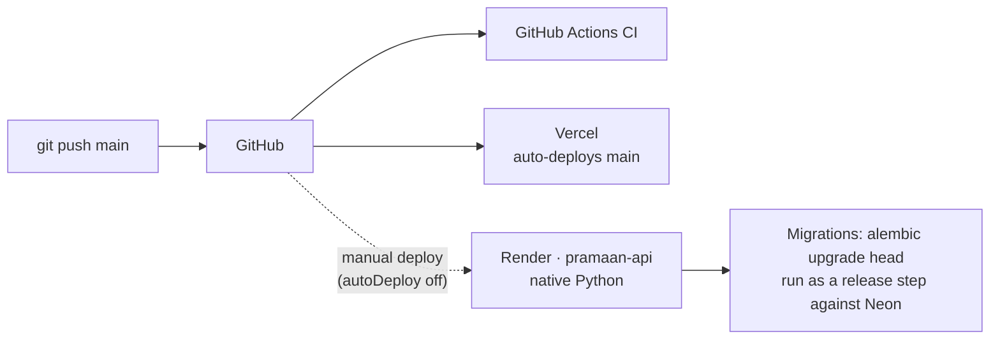

| Target | How |
| --- | --- |
| **Frontend → Vercel** | Deploys automatically from `main` as a static Vite build (`vercel.json`: framework `vite`, output `dist/`). App routes are rewritten to `index.html`; any other path gets `404.html` with a real 404 status. Security headers are served from `vercel.json`; the Content-Security-Policy is a `<meta>` tag generated at build time from the environment. Configure the `VITE_*` variables (no secrets in the frontend). |
| **API → Render** | Native Python service defined in `render.yaml`: `pip install -r requirements.txt`, then gunicorn with one Uvicorn worker (long timeout for SSE). Deploy from the dashboard or `render deploys create <service-id>`. |
| **Database → Neon** | Use the **pooled** connection string for `DATABASE_URL` and the direct one for `MIGRATIONS_DATABASE_URL`. Run `alembic upgrade head` whenever the schema changes — never at service start. |
| **Files → Supabase Storage** | Private bucket, S3 endpoint `https://<project-ref>.supabase.co/storage/v1/s3`, path-style addressing. |
| **Redis → Upstash** | Optional; must be `rediss://` (TLS) in production. |

Production refuses to start without TLS to the database, durable object storage, the Groq and OpenRouter keys, and a TLS Redis URL (if Redis is set).

---

## 14. Configuration reference

### Backend (`backend/.env`, Render environment)

| Variable | Purpose |
| --- | --- |
| `ENVIRONMENT` | `development` · `test` · `production` |
| `DATABASE_URL`, `MIGRATIONS_DATABASE_URL` | Neon pooled / direct connection strings |
| `CORS_ORIGINS` | Comma-separated allowed origins (no wildcards) |
| `FIREBASE_PROJECT_ID` | Firebase project used to verify ID tokens |
| `LLM_PROVIDER`, `GROQ_API_KEY`, `GROQ_MODEL` | Text generation (`groq` or `fake`) |
| `GROQ_STT_MODEL`, `MAX_AUDIO_BYTES`, `SPEECH_PER_MINUTE` | Voice-input fallback (default `whisper-large-v3-turbo`, 10 MB, 12 per user per minute) |
| `EMBEDDING_PROVIDER`, `OPENROUTER_API_KEY`, `EMBEDDING_MODEL`, `EMBEDDING_DIM` | Embeddings (`openrouter` or `fake`); dimension must stay 768 |
| `OPENROUTER_TIMEOUT_S`, `OPENROUTER_RETRIES` | Embedding call bounds (default 25 s, 1 retry) |
| `TAVILY_API_KEY`, `OPENALEX_MAILTO` | Web and academic search |
| `STORAGE_BACKEND`, `S3_ENDPOINT`, `S3_REGION`, `S3_BUCKET`, `S3_ACCESS_KEY_ID`, `S3_SECRET_ACCESS_KEY` | `local` or `s3` (Supabase) |
| `REDIS_URL` | Optional Redis (`rediss://` in production) |
| `RESEARCH_CONCURRENCY`, `INDEXING_CONCURRENCY`, `JOB_LEASE_S`, `JOB_MAX_ATTEMPTS`, `RESEARCH_TIMEOUT_S` | Job worker tuning |
| `MAX_UPLOAD_BYTES`, `RATE_LIMIT_PER_MINUTE` | Request limits |
| `LANGSMITH_API_KEY` | Optional LangGraph tracing |

### Frontend (`.env.local`, Vercel environment)

| Variable | Purpose |
| --- | --- |
| `VITE_DATA_SOURCE` | `api` or `mock` (demo mode) |
| `VITE_API_URL` | Backend base URL (also added to the CSP `connect-src`) |
| `VITE_FIREBASE_*` | Firebase web config; `VITE_FIREBASE_USE_EMULATOR=true` for the emulator (refused in production builds) |
| `VITE_FIREBASE_APPCHECK_SITE_KEY` | Optional App Check (reCAPTCHA v3) |

These are read at build time and embedded in the bundle, so change them in Vercel and redeploy.

---

## 15. Repository layout

| Path | Contents |
| --- | --- |
| `index.html`, `app/main.tsx`, `app/router.tsx` | Entry page, React root and the route table |
| `app/root.tsx`, `app/routes/` | Root layout, error and not-found pages; route modules per area (marketing, auth, workspace, projects, settings, shared) |
| `components/` | Design system (`ui`, `brand`, `animations`) and feature components (`research`, `library`, `projects`, `settings`, `layout`, …) |
| `lib/services/` | The frontend service boundary |
| `lib/api/` | API client and typed adapters |
| `lib/mock/`, `data/` | Demo-mode adapters and seed data |
| `lib/firebase/` | Firebase initialisation (auth, optional App Check and Analytics) |
| `lib/security/`, `lib/hosting.ts`, `vercel.json`, `vite.config.ts` | Security headers / CSP, SPA rewrites and 404s, build config |
| `lib/speech/` | Voice input (speech recognition + recording fallback) and report narration |
| `lib/utils/`, `lib/hooks/` | Shared logic and React hooks |
| `tests/`, `e2e/` | Vitest unit tests; Playwright smoke and workflow suites |
| `backend/app/api/` | FastAPI routes and dependencies |
| `backend/app/services/` | Business logic, job worker, storage, providers (`llm/`), documents |
| `backend/app/research/` | LangGraph graph, agent nodes, prompts, citation mapper |
| `backend/app/repositories/`, `backend/app/db/` | Data access, models, Alembic migrations |
| `backend/tests/` | Backend test suite |
| `render.yaml` | Render service definition |
| `.github/workflows/ci.yml` | Continuous integration |
