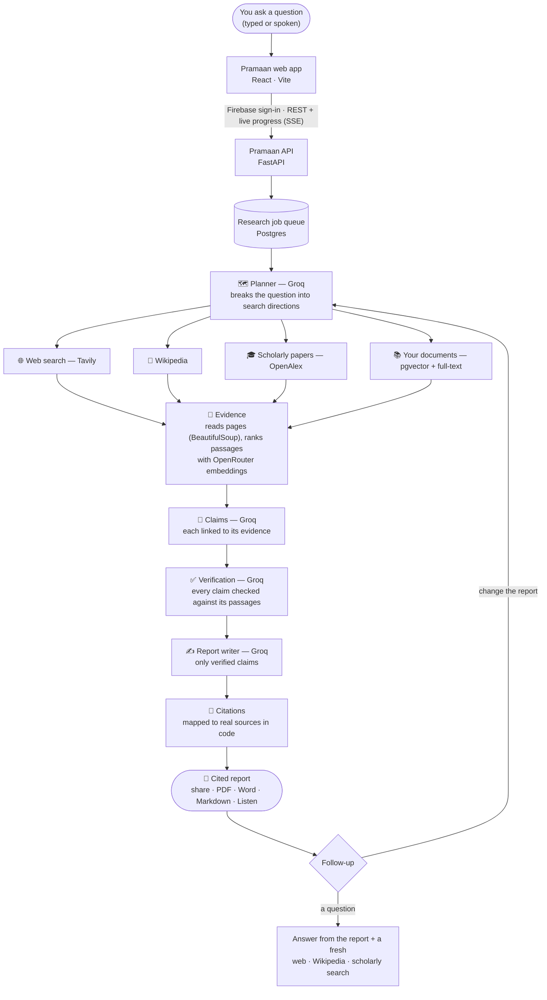

# Pramaan AI

**Research, with evidence.** Ask a question and Pramaan's research agents search the web, Wikipedia, scholarly papers and your own documents, read the sources, verify every claim against the evidence and write a cited report. Every citation points to a real source; models never invent references.

**Live app:** [pramaan-207-148-12-93.sslip.io](https://pramaan-207-148-12-93.sslip.io)

## What you can do

- **Research any question** in three depths: **Quick** (about 10 cited sources), **Standard** (about 35) and **Deep** (about 50), and watch each step happen live.
- **Trust the answer.** Claims are checked against verbatim passages and marked supported or partially supported; unsupported ones are left out. Click any citation to see the exact passage.
- **Use your own documents.** Upload PDFs, Word files, notes or web pages to your library or a project, and research them alongside public sources.
- **Ask follow-ups.** Questions are answered from the report plus a fresh search. Requests like "make it shorter" or "focus on India" regenerate a new version, and the original stays untouched.
- **Share and export.** Share a read-only link, or export a styled PDF, a Word document or Markdown that contains only the report.
- **Speak and listen.** Dictate questions with the mic, and have reports read aloud with Listen.
- **Organise.** Projects with shared members and instructions, a searchable library, and full history.

## How it works



## Tech stack

| Layer | Technology |
| --- | --- |
| Frontend | React 19, Vite 8, React Router 8, TypeScript, Tailwind CSS v4, Framer Motion |
| Backend | Python 3.12, FastAPI, LangGraph (agent pipeline), SQLAlchemy (async), Alembic, BeautifulSoup |
| Data | PostgreSQL with pgvector (vector + full-text search) |
| Testing | Vitest, Playwright, pytest, ruff, mypy; GitHub Actions CI |

## External services

| Service | Used for |
| --- | --- |
| **Groq** | Language model (`openai/gpt-oss-120b`) for planning, claims, verification and writing; Whisper for voice input |
| **OpenRouter** | Text embeddings for ranking evidence and searching documents |
| **Tavily** | Web search |
| **Wikipedia** (MediaWiki API) | Encyclopedia articles |
| **OpenAlex** | Scholarly papers and abstracts |
| **Firebase Authentication** | Sign-in (email, Google) |
| **Neon** | Managed PostgreSQL + pgvector |
| **Supabase Storage** | Uploaded files (S3-compatible) |
| **Upstash Redis** | Caching, rate limits and live progress (optional) |
| **Vultr** | Hosting: one server running the web app and API in Docker behind Caddy (automatic HTTPS) |

## Run it locally

**Demo mode** (no backend or keys needed):

```bash
npm install
VITE_DATA_SOURCE=mock npm run dev                 # http://localhost:3000
```

**Full stack** (Node 22, Python 3.12, PostgreSQL with `pgvector`):

```bash
# API
cd backend
python3.12 -m venv .venv && .venv/bin/pip install -r requirements-dev.txt
cp .env.example .env                              # add your service keys
.venv/bin/alembic upgrade head
.venv/bin/uvicorn app.main:app --reload --port 8000

# Web app (repository root)
cp .env.example .env.local                        # Firebase web config + VITE_API_URL
npm run dev
```

**Deploy** (Vultr): `deploy/vultr/deploy.sh <server-ip>` builds the web app, uploads it with the API, and restarts the containers (`--migrate` also runs database migrations). It reads two gitignored files, `deploy/vultr/web.env` and `deploy/vultr/api.env`.

**Checks:** `npm run lint && npm run typecheck && npm test && npm run build` for the web app, and `ruff`, `mypy` and `pytest` in `backend/`.

## Project layout

```
src/        React app: routes, components, services, export and voice
backend/    FastAPI API, LangGraph research agents, database models and migrations
tests/      Frontend unit tests          e2e/   Browser test suites
public/     Static assets                deploy/vultr/   Server setup, Docker Compose, Caddy, deploy script
```
